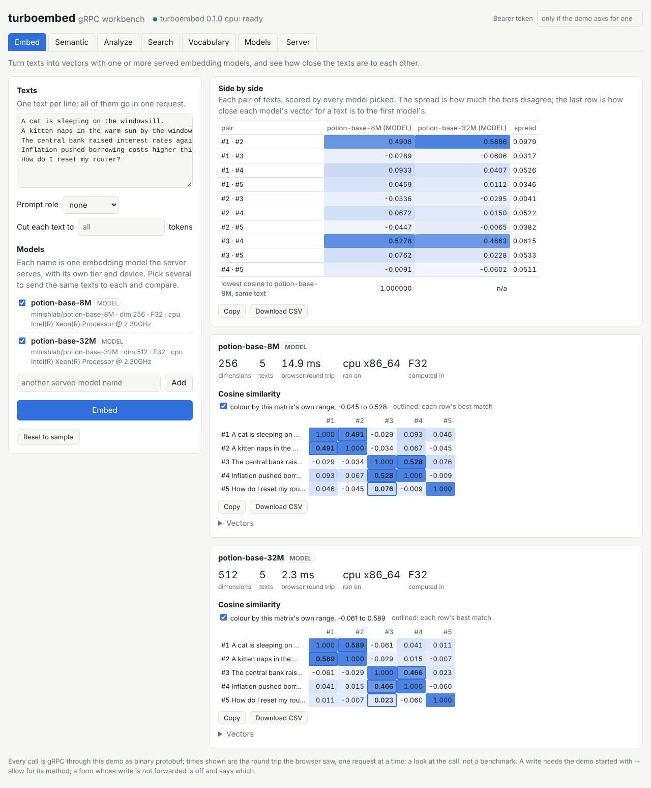
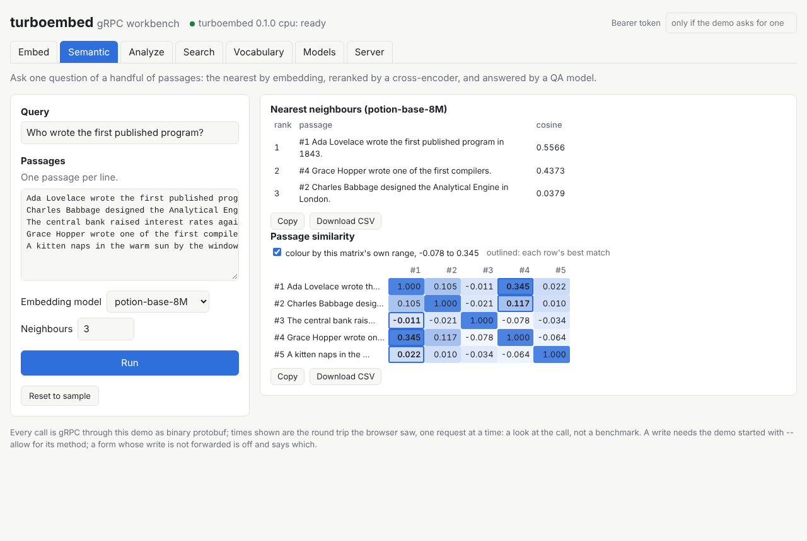
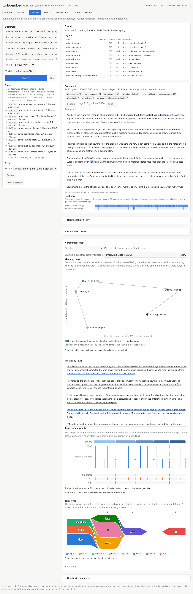
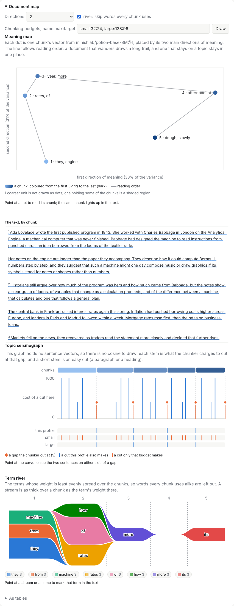
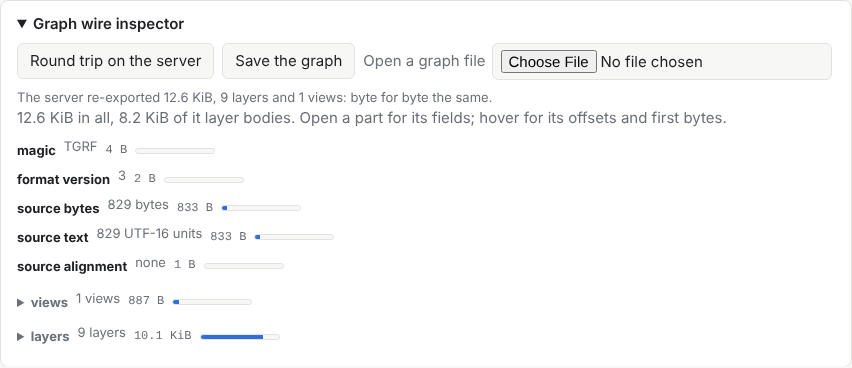
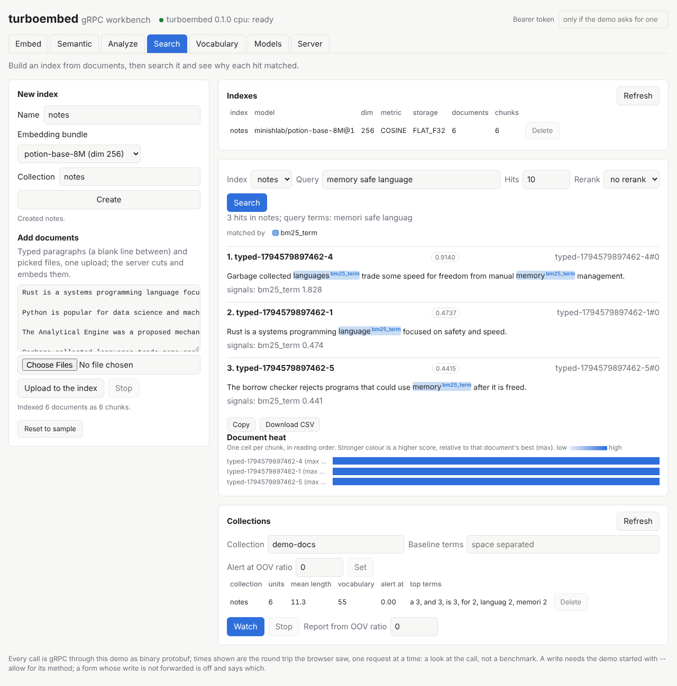
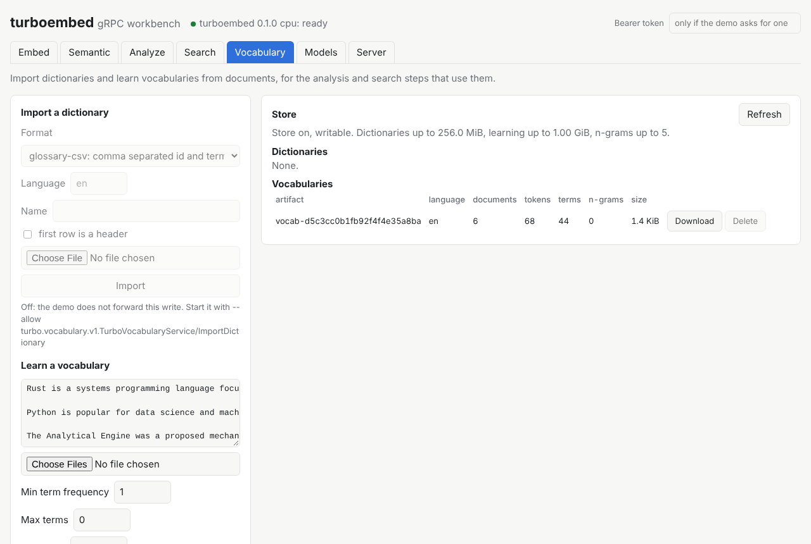
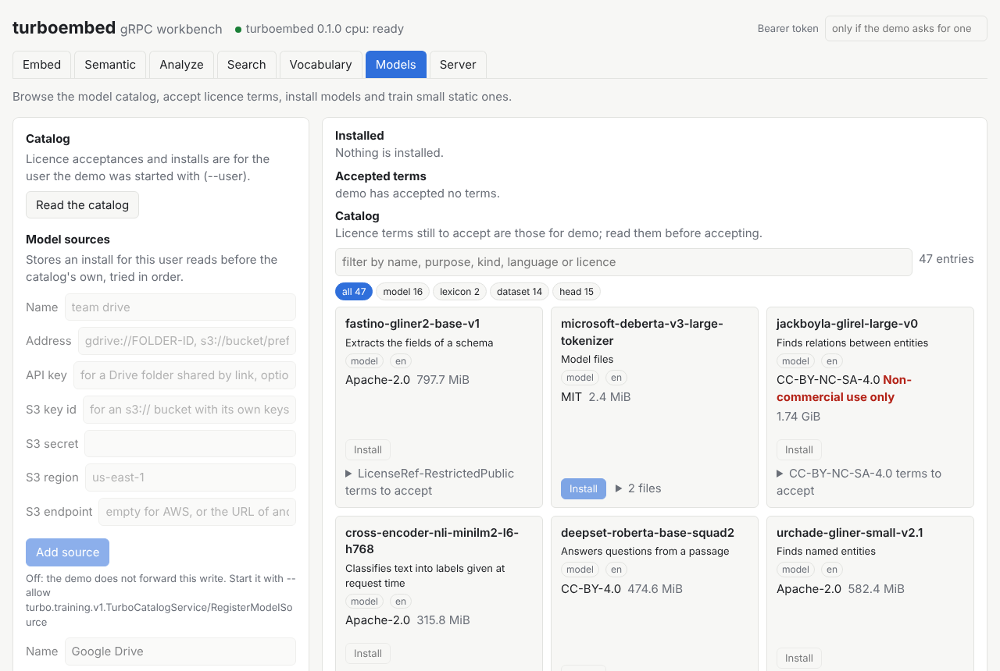
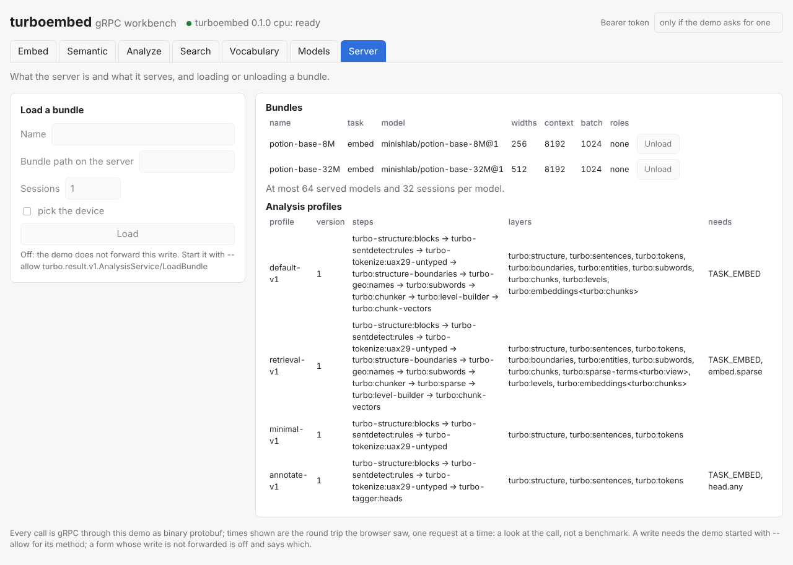

# The demo page

`turbo-kserve-demo` is a small web workbench for trying a running
`turbo-kserve` (docs/grpc.md) from a browser: compare embedding models,
watch a document's analysis arrive step by step, build and search an
index, learn and import vocabularies, and see what the server serves.

It is a client of the server and nothing more. Browsers cannot make
plain gRPC calls, so the demo is a separate binary that serves the page
and bridges the Connect protocol to the server's gRPC: each call the
page makes is the same call, with the same protobuf bytes, any gRPC
client makes. It links no backend, loads no model and decodes no
message; the server is unchanged by it, and it works against a server
on any backend. The page is plain HTML, CSS and JavaScript compiled into
the binary: it loads nothing from any other host, so it works on a
machine with no network beyond the one to the server.

The page is written in TypeScript under `demo/web/src` over the
generated Connect clients (`demo/web/src/gen`) and bundled into
`demo/static/app.js` (Building the page, below).

## No JSON front end

RPC payloads between the page and the server are binary protobuf
through Connect-ES only. The page's clients are generated from the
protos by `@bufbuild/protoc-gen-es` and call the demo with
`@connectrpc/connect-web` using the binary codec: `application/proto`
for unary calls and `application/connect+proto` for streams, each a
`POST /<package>.<Service>/<Method>` that the demo forwards to the
server when the method is on its allowlist. Raw file uploads are an
`HTTP PUT` of binary frames to the demo's upload endpoints, which feed
the client-streaming RPCs, up to the 2 GiB request cap (see Uploads).

JSON is allowed only at the edges where it fits, such as processing a
form. There it stays small and local, and it never carries or mirrors a
proto message. It is never a general front-end layer and never in the
RPC path: there are no `/api/*` JSON, NDJSON or SSE routes, no serde
derives on generated proto types and no hand-written JSON or base64
mapping of messages; GET answers only the static page.

The reason: once JSON is in, agents keep pushing it into the hot path,
and that has forced several rewrites (the latest: #1271, #1370).

`bench/tests/tree.rs` (tree/front_end.rs) enforces the RPC-path part,
where it can be exact: `demo/Cargo.toml` has no `serde` or
`serde_json`, the server has neither outside its tests, no `build.rs`
that compiles the protos adds a serde attribute, and no `"/api/` route
string is in `demo/src`. It does not look at JSON anywhere else, and it
has no pending list: it holds for the whole RPC path.

## The Connect bridge

Each call is a `POST /<package>.<Service>/<Method>`, the gRPC method's
own path, in one of two forms of the Connect protocol, the binary codec
only:

| Content type | Methods | Request | Answer |
|---|---|---|---|
| `application/proto` | unary | the request message | HTTP 200 and the reply message, `application/proto`; or the error below |
| `application/connect+proto` | unary and server-streaming | the request message in one envelope | HTTP 200, `application/connect+proto`: each reply message in an envelope, then the end-of-stream envelope |

An envelope is one flags byte, the length as four bytes big-endian, and
the message. The end-of-stream envelope has flags `0x02` and holds JSON,
by the protocol's definition: `{}` when the call succeeded, else
`{"error": {"code": "not_found", "message": "..."}, "metadata":
{"turbo-code": ["1280"], "turbo-field": ["0"]}}`. A unary error is the
HTTP status of its code (`not_found` 404, `invalid_argument` 400,
`unavailable` 503, and the rest of the protocol's table), the body
`{"code": ..., "message": ...}` as `application/json`, and the server's
`turbo-code` and `turbo-field` as response headers, where Connect
clients read a unary error's metadata. Only the server's `turbo-*`
metadata is passed on. These JSON bodies carry a status, never a
message.

The demo passes the bytes through: a gRPC codec on its side leaves each
message as the bytes it is (`demo/src/codec.rs`), so the request goes to
the server and the reply comes back unchanged, over one HTTP/2 channel
to the server shared by every call. When the page goes away mid-stream,
the demo drops its call and the server sees it cancelled.
`connect-timeout-ms` becomes the gRPC call's deadline.

Refused before any call to the server:

| Request | Answer |
|---|---|
| Any other content type, JSON included, or none | HTTP 415, `accept-post: application/proto, application/connect+proto` |
| A server-streaming method as `application/proto` | HTTP 415 |
| A method the demo knows but does not forward | `permission_denied` |
| A path that is no unary or server-streaming method | `unimplemented` |
| A compressed request or message | `unimplemented` |
| A streaming request that is not exactly one uncompressed envelope | `invalid_argument` |
| A message over 64 MiB, the server's default limit, refused before it is read when Content-Length or the envelope says so | `resource_exhausted` |
| GET on a method's path | HTTP 405, `allow: POST` |

The demo forwards a request message of up to 64 MiB and a reply message
of up to 256 MiB, the server's defaults (`demo/src/limits.rs`,
docs/grpc.md).

GET answers `/`, `/app.js` and `/style.css` only.

### The allowlist

The demo knows every unary and server-streaming method of the server's
services (`demo/src/allow.rs`, checked against `server/proto` by
`demo/tests/methods.rs`). The ones that only read are forwarded by
default; one that changes the server (loading a bundle, an index or
collection write, a licence acceptance, `InstallModel`,
`TrainStaticModel`, a delete) only when named with `--allow`, and the
server still refuses it unless started with `--admin`. A name given to
`--allow` that is not in the table stops the demo at startup. Anything
not in the table is refused `unimplemented` and a write not named is
refused `permission_denied`, both before any bytes go to the server.
The four client-streaming methods are in the table as uploads, all
writes: they are reached only by `HTTP PUT` (see Uploads), and a Connect
`POST` to one is refused `unimplemented`. The gRPC health and reflection
services, the rest of `TurboSinkService` and every bidi method are not
in the table.

One call the demo answers itself, with no call to the server:
`POST /turbo.demo.v1.DemoService/Describe` (`demo/proto/turbo_demo.proto`),
unary, `application/proto` only, behind the gate like any other call.
Its reply lists the write methods the demo forwards (`forwarded_writes`,
each `/<package>.<Service>/<Method>`, uploads included) and whether the
demo has a user (`has_user`). The page asks it first, so it can turn
off what would be refused (What the page shows). `demo/tests/describe.rs`
checks the reply and that the path and fields are the proto's.

### Uploads

A file goes to the server as an `HTTP PUT` to `/upload` followed by the
client-streaming method's own path (`demo/src/upload.rs`,
`demo/src/frames.rs`). Uploads pass the same gate, TLS and allowlist as
any call; all four are writes, so none is forwarded unless named with
`--allow` (by its method path), and the server still applies its own
checks.

| Endpoint | Body after the content type |
|---|---|
| `PUT /upload/turbo.vocabulary.v1.TurboVocabularyService/ImportDictionary` | one `ImportDictionaryHeader` frame, then the dictionary's raw bytes |
| `PUT /upload/turbo.vocabulary.v1.TurboVocabularyService/LearnVocabulary` | one `LearnVocabularyHeader` frame, then one `LearnVocabularyDocument` frame per document |
| `PUT /upload/turbo.search.v1.TurboSearchService/IndexDocuments` | one `IndexDocumentRequest` frame per document |
| `PUT /upload/turbo.sink.v1.TurboSinkService/StreamDocuments` | one `DocumentSinkItem` frame per item |

The content type must be `application/octet-stream`; any other, JSON and
multipart included, is HTTP 415 with `accept: application/octet-stream`.
A frame is the Connect envelope: a flags byte that must be 0, the length
as four bytes big-endian, then the binary protobuf message. The demo
cuts the body into frames as it arrives and sends each to the server as
one message of the stream, wrapping a header or document frame in the
request's `oneof` without decoding it; a dictionary's raw bytes go in 4
MiB chunks. Nothing is buffered beyond one frame or chunk, so the server
starts on the upload before the body has ended.

The answer is HTTP 200, `application/proto`, with the reply message as
bytes. An error has an empty body and its status in headers:
`grpc-status`, `grpc-message` (percent-encoded) and the server's
`turbo-code` and `turbo-field`, with the HTTP status of the code from the
table above. Refused by the demo:

| Request | Answer |
|---|---|
| Not on the allowlist, or a write not named with `--allow` | 403, `permission_denied`, before the server is reached |
| A path that is no upload | 501, `unimplemented` |
| A frame with flags other than 0, or a body that ends inside a frame | 400, `invalid_argument` |
| A frame over 64 MiB less 16 bytes (room for the wrapping), the server's message limit | 429, `resource_exhausted`, as soon as its length is read |
| A `Content-Length` over 2 GiB, or a body whose frames reach the server's 2 GiB stream ceiling (#1414) | 413, `resource_exhausted`, at once or as soon as the frame crossing it is read |
| GET or POST on an upload path | 405, `allow: PUT` |

The 2 GiB cap counts what is forwarded (each message and its five-byte
gRPC prefix), the way the server counts it, so the demo refuses first; a
body near the cap whose frames are wrapped can be refused a few bytes
before 2 GiB of body. The server keeps its own per-call caps where it
holds the input in memory: an imported dictionary of at most 256 MiB and
a learning corpus of at most 1 GiB. A PUT has no deadline.

### The gate

Before the allowlist, each call passes two checks
(`demo/src/gate.rs`):

- Origin. The page is served from the demo's own origin, so a call with
  an `Origin` header that does not match the listener's HTTP/HTTPS scheme
  and the request's `Host` with its effective port is refused
  `permission_denied`, and no CORS header is sent. Origins named with
  `--cors-origin` are let in: their calls get
  `access-control-allow-origin` with that origin and may read
  `turbo-code`, `turbo-field`, `grpc-status` and `grpc-message`, and
  their preflight (`OPTIONS` asking for `POST` or `PUT`) is answered 204
  with `access-control-allow-methods: POST, PUT`. Any other preflight is 403 with no CORS
  headers. Default ports (HTTP 80 and HTTPS 443) are normalized, including
  configured origins; malformed ports and non-HTTP schemes are rejected.
  Forwarded scheme headers do not change this check. There is no wildcard;
  `*` and an origin with a path stop the demo at startup.
- Token. With `--token-file` (or `TURBO_DEMO_TOKEN`) every call must
  carry `authorization: Bearer <token>`; without it, or with another,
  it is refused `unauthenticated` (401). The page's files need no token.
  There is no token by default. The demo will not start on an address
  other than loopback with a write allowed and no token.

With `--tls-cert` and `--tls-key` the demo serves HTTPS (TLS 1.2 and
1.3, HTTP/1.1, the same ring provider as the server) and plain HTTP is
not answered. A certificate or key that does not load stops the demo at
startup. A token sent off loopback without TLS crosses the network in
the clear; the demo says so when it starts.

### The user

Every catalog method that names a user (`ListModelCatalog`,
`RecordLicenceAcceptance`, `RevokeLicenceAcceptance`,
`ListLicenceAcceptances`, `InstallModel`, `DescribeModel`,
`ResolveModel`, `ReadModelFile`, `ListModelSources`,
`RegisterModelSource`, `RemoveModelSource`, `StartDriveSignIn`,
`FinishDriveSignIn`) acts for the user the demo was started
with, `--user`, never for a name the page sends: the demo drops the
message's user field and writes its own (`demo/src/user.rs`, the one
place it looks inside a message). Without `--user` the field is
cleared, so reads name no user, and a catalog write is refused
`permission_denied` before the server sees it. `LoadBundle` names the
same user (its field 12), so a bundle under terms that need acceptance
loads only once that user accepted them; without `--user` the field is
cleared and only bundles that need no acceptance load. A message that
is not well formed protobuf is refused `invalid_argument`. The token
says who may call; `--user` says who those calls are for, so a demo
shared by several people should run one instance, with its own token,
per person.

## Generated clients

The page's protobuf and Connect-ES code is generated, never written by
hand: `scripts/generate-web-stubs.sh` runs `buf generate` with
`server/proto/buf.gen.yaml` and `protoc-gen-es` v2 (`target=ts`) into
`demo/web/src/gen`, one `*_pb.ts` per proto file with its message
schemas and service descriptors, then the same for the demo's own
service with `demo/proto/buf.gen.yaml`. The output is committed; the `proto` CI
job regenerates it and fails on any difference, so a `.proto` change
lands with its regenerated TypeScript. The script needs Node and npm and
installs the exact versions in `demo/web/package-lock.json`
(docs/release.md); no `build.rs` runs it, and `cargo build` needs
neither.

## Building the page

`scripts/build-web.sh` type checks `demo/web` with `tsc`, runs the unit
tests in `demo/web/test` under Node (the page's SHA-256 against Node's,
and the upload bodies decoded frame by frame), and bundles
`demo/web/src/main.ts` with esbuild into `demo/static/app.js`, an
unminified ES module. The bundle is committed, so `cargo build` needs no
Node; the `proto` CI job rebuilds it with `--check` and fails on any
difference. TypeScript 7.0.2 and esbuild 0.28.2 are pinned exactly in
`demo/web/package.json`, beside the generator pins; the page has no UI
framework.

In `demo/web/src`, `rpc.ts` makes the one Connect transport (binary,
POST only, the bearer token from the page's token field) and a client
per service, and `upload.ts` makes the one request outside them, the
upload PUT, as an `XMLHttpRequest` because that reports how much of the
body has gone out;
`frames.ts` builds the upload bodies as Blobs, so a picked file is sent
from disk without being read into memory, and `sha256.ts` hashes a
dictionary for its import header. The tree test
(`bench/tests/tree/front_end.rs`) holds the page's own TypeScript to
this: no `JSON.`, `toJson`, `fromJson`, `application/json` or
`connect+json`, no JSON or GET transport, and no `fetch` or
`XMLHttpRequest` outside `upload.ts`.

While an upload's body goes out the page shows a bar and the bytes sent
of the total, then that the server is working on it, and every upload
(documents to an index, a dictionary, documents to learn from) has a
Stop that aborts it.

The page keeps to a few layout rules, which the browser run (Tests,
below) checks on every tab at 1280 and 390 CSS pixels: the page never
scrolls sideways, a wide table scrolling inside its card instead; no
control leaves the box it is in, a long select or file picker shrinking
to the box's width; a card with nothing in it is not drawn; and a list
with no rows says "None." in place of bare column headings. The tabs
are an ARIA tab list: the left and right arrow keys move between them.
Each tab is an address (`#search`) and a history entry: a link opens its
tab, and Back and Forward move between the tabs visited.
The header shows the server's name, version and state with a dot, green
once `ServerReady` says ready and red when the demo cannot reach it. The
state is read again every 10 seconds while the page is in view and when
it comes back into view. While the server does not answer, a notice
under the tabs says so and offers "Retry now", and a list with nothing
in it says why: the server is not reachable, or it serves none of that
kind. When the server answers again, or turns ready after loading, every
tab reads its lists again, with no reload. A demo that refuses a call
for want of its token counts as reachable: type the token and the tabs
fill.

Every action follows one pattern. A button that calls the server is off
and shows the elapsed time while its call runs, and a Stop button is on
only while there is something to stop. Anything that removes state
(delete an index, a collection, a vocabulary artifact or a static
model, unload a bundle, revoke a licence acceptance, remove a model
source) asks in place first, "Delete demo?" with Yes and Cancel, and
reports a refusal beside the row it concerns. While Yes is running the
question stays put: Escape does not bring the first button back.

## Starting it

Build both binaries:

```
cargo build --release -p turbo-kserve -p turbo-kserve-demo
```

Start the server with the models to try. To compare tiers, serve one
bundle under one name per tier (docs/grpc.md, Flags):

```
target/release/turbo-kserve --listen 127.0.0.1:8081 \
    --model bundle=/models/bge-small-en-v1.5,device=0,sessions=2 \
    --model name=bge-small-fastest,bundle=/models/bge-small-en-v1.5,device=0,sessions=2,precision=PRECISION_FASTEST \
    --model name=bge-small-exact,bundle=/models/bge-small-en-v1.5,device=0,sessions=2,precision=PRECISION_EXACT
```

Then the demo:

```
target/release/turbo-kserve-demo --server http://127.0.0.1:8081
```

and open `http://127.0.0.1:8080`. To let the page train a static model
on a server started with `--admin`:

```
target/release/turbo-kserve-demo --server http://127.0.0.1:8081 \
    --allow /turbo.training.v1.TurboTrainingService/TrainStaticModel
```

| Flag | Meaning | Absent |
|---|---|---|
| `--listen ADDR:PORT` | Where the page is served. | `TURBO_DEMO_LISTEN`, else `127.0.0.1:8080`. |
| `--server URL` | The server to call, `http://HOST:PORT` or `https://HOST:PORT`. HTTPS requires an explicit trusted CA. | `TURBO_DEMO_SERVER`, else `http://127.0.0.1:8081`. |
| `--server-tls-ca PEM` | Trust this CA certificate chain for the upstream gRPC server. | `TURBO_DEMO_SERVER_TLS_CA`, else no upstream TLS. |
| `--server-tls-cert PEM`, `--server-tls-key PEM` | Present this client identity to the upstream server; both or neither. | `TURBO_DEMO_SERVER_TLS_CERT` and `TURBO_DEMO_SERVER_TLS_KEY`. |
| `--server-tls-name NAME` | Verify this certificate name when dialing a different address. Trust and name verification stay enabled. | `TURBO_DEMO_SERVER_TLS_NAME`, else the URL host. |
| `--allow METHOD` | Also forward this method that changes the server, `/<package>.<Service>/<Method>`; repeat for more. A name that is not a known method stops the demo at startup. | `TURBO_DEMO_ALLOW`, comma-separated, else the reads only. |
| `--token-file PATH` | A file holding the bearer token every call must carry. | `TURBO_DEMO_TOKEN_FILE`, else the token in `TURBO_DEMO_TOKEN`, else none. |
| `--user NAME` | Who the page's licence acceptances and installs are for (see The user). | `TURBO_DEMO_USER`, else none: the catalog calls name no user and the Models tab is read-only. |
| `--cors-origin ORIGIN` | Another origin whose pages may call, `http(s)://HOST[:PORT]`; repeat for more. | `TURBO_DEMO_CORS_ORIGINS`, comma-separated, else none. |
| `--tls-cert PEM`, `--tls-key PEM` | Serve HTTPS with this certificate chain and private key; both or neither. | `TURBO_DEMO_TLS_CERT` and `TURBO_DEMO_TLS_KEY`, else plain HTTP. |

The demo serves on the loopback address with no token unless told
otherwise. It need not start after the server: it connects
on each call, and a call while the server is down is `unavailable`.

The upstream client settings are separate from the page's `--tls-cert`
and `--tls-key`. For an mTLS upstream, mount a dedicated client identity
and the server CA, then start the page with:

```sh
turbo-kserve-demo --server https://127.0.0.1:8081 \
  --server-tls-ca certs/server-ca.pem --server-tls-name localhost \
  --server-tls-cert certs/client.pem --server-tls-key certs/client.key
```

There is no plaintext retry or insecure certificate option. An HTTPS
URL without a CA, an HTTP URL with TLS settings, or an incomplete client
identity is refused. Flags override the corresponding environment values.
Library callers use `Options.upstream_tls: Option<UpstreamTls>` and the
paired `ClientIdentity` type. The server's private key is never used as
the client's key automatically.

SIGTERM and SIGINT (Ctrl-C) stop the demo: it closes the listener and
ends every open stream there with an `unavailable` end-of-stream
envelope, message `the demo is stopping`, so a `WatchCollection` a page
holds open does not hold the stop. Calls in flight get 5 s to finish;
one still open then (a request whose body never arrives, say) is cut,
and the demo logs `calls still open after 5 s were cut`. Library callers
get the same from `Demo::stop`, and choose the wait with
`Demo::stop_within`, which answers whether every call ended by itself.
A stream the
server ends because it is stopping reaches the page with the server's
message, `the server is stopping`.

## What the page shows

The page has a tab per area; leaving a tab cancels its streams and
uploads. Writes (marked below) are refused with `permission_denied`
unless the demo is started with `--allow` for them. The page asks the
demo which writes it forwards (`DemoService/Describe`) before it draws
anything: a form whose write is not forwarded is off, with a line
naming the `--allow` that enables it, and so is each delete, unload,
install, accept and revoke control.
A demo that wants a token answers only once the token is typed: until
then nothing is off, and when the answer arrives every form and control
follows it.

A refused or failed call is reported as one plain sentence that says
what to do where that is known ("Pick or create an index first."), with
the call's code, `turbo-code`, field and raw message behind a "details"
toggle (`demo/web/src/errors.ts`). An empty input the page can see (no
index picked, no query, no document) is said before the server is
asked. Every input and select has a visible label or an accessible
name. Options that need a kind of model show only when one applies: the
open-span options on Analyze with an open-span model picked, the
relation model when one is served and its options when one is picked,
and the reranker and QA selects on Semantic when the server serves that
task. What is typed in a hidden group is kept.

Results are drawn so they can be read without the numbers
(`demo/web/src/heat.ts`, `marks.ts`, `highlight.ts`):

- A similarity table is coloured by its own lowest and highest
  off-diagonal cosine, which it names, so a model whose cosines all sit
  in a narrow band still shows which pairs are closer. A switch goes
  back to the absolute scale from 0 to 1, and each row's best match is
  outlined.
- Annotated text has a legend, a colour per picked layer: the first
  fills, the next underlines, so layers over the same words stay
  apart. With no layer picked the text marks what was named, or its
  sentences when nothing was, or every layer when it has neither. A
  marked stretch can be clicked, or reached with Tab, to list
  every annotation on it with its layer, label and score. The legend
  names a picked layer as its chip does, instance included.
- A search hit marks the words that matched in place, each with the
  signal that matched it, and the legend names the signals. Signals
  whose spans the page cannot place in the chunk are named under the
  hit.
- The search heat and the Analyze heatmap each say what their colour
  means and show the scale.
- Where the layout is one column (820 px and narrower), a finished
  run brings its results into view, without animation when the
  visitor asked for less motion.

Each tab opens with one line on what it does. When the server serves
nothing a tab can use, Embed, Semantic and Search say what they need
and where to get it (`demo/web/src/about.ts`); a model the server no
longer serves leaves the Embed list.

What is typed or picked on Embed, Semantic, Analyze, Search and
Vocabulary is kept in the browser's `localStorage` and put back after a
reload, the models picked on Embed included; "Reset to sample" under a
tab's form puts that tab back and forgets what was kept
(`demo/web/src/keep.ts`). A pick from a list the server fills (a
model, an index) is put back the first time the list offers it; after
that the list keeps what is picked now, so the index the page picks
after creating one stays picked. A password, a picked file, and everything on
Models and Server are never kept, and the bearer token stays in
`sessionStorage`. With storage blocked the page works the same and
keeps nothing.
What is kept stays in that browser until Reset or until the site's data
is cleared, so on a shared machine use Reset, or a private window,
after pasting text that others should not read.

The similarity matrices, the vectors, the side-by-side table, the
nearest neighbours, the rerank scores and the search hits each have
"Copy" and "Download CSV" (`demo/web/src/csv.ts`). The file is CSV as
RFC 4180 writes it, with the full texts and six decimals (the vectors
as the server sent them); Copy puts the same rows on the clipboard
separated by tabs, which a spreadsheet pastes into cells. A value that
a sheet would read as a formula (it starts with `=`, `+`, `-` or `@` and
is not a number) gets a leading apostrophe in both. Both are
built in the page from values it already has; nothing is asked of the
server and there is no JSON.

- Embed: each served embedding bundle (from `Capabilities`) with its
  tier, model id, dimensions, compute type and device from
  `ModelMetadata`'s properties. For each model picked, one `ModelInfer`
  with every text as one batch: the vectors' dimensions, where it ran,
  the round trip, the cosine similarity of every pair of texts, and the
  first values and norm of each vector. With more than one model picked,
  every pair's similarity side by side with the spread between the
  models, and the lowest cosine between each model's vector for a text
  and the first model's. This is where a tier's trade-off shows: a
  device that runs FASTEST in a narrower type gives slightly different
  numbers than at EXACT. The CPU computes every tier in F32
  (docs/cpu.md), so there the columns are the same. Optional parameters
  are a prompt role (`prompt_role`) and a token budget per text
  (`max_tokens` with `truncate` `TRUNCATE_RIGHT`).
- Semantic: one query against passages, one per line. With an
  embedding bundle, the query embedded with prompt role
  `PROMPT_QUERY` and the passages with `PROMPT_DOCUMENT` (when the
  bundle lists the role), the nearest passages by cosine, and the
  passages' similarity matrix. With a reranker, `ModelInfer` with
  `query` and `passages` (docs/kserve.md, Tasks), in calls of at most
  the model's `max_batch` passages, ranked by logit. With an extractive
  QA model, `ModelInfer` with `question` and the passages as one
  `context`, the `top_k` answer spans decoded from their UTF-8 byte
  offsets, with score, probability and the no-answer probability.
- Analyze: `AnalyzeDocumentProgressive` as it streams, each step with
  its time and layers and any failed step with what it skipped; then
  the finished graph through `InspectDocumentWindow`, the text with its
  annotations marked, a chip per layer instance to filter text annotations, paging, and
  heatmap lanes (unfiltered). Named chips show `[instance]` and select that
  instance independently through `filter_layer_instances`; and `FormatDocument` in any format `ListOutputFormats`
  names, shown when it is text and offered as a download. An open-span model
  enables caller entity labels, optional label=prompt guidelines, threshold,
  and flat or nested decoding. A
  separate relation model adds caller relation labels, threshold, and sentence
  scoping over those entities, so one run produces entity and relation evidence
  and edges. The graph retains model identities and source offsets.
  Five panels below it each call when opened, and again when the graph changes:
  - Normalization X-Ray: `InspectDocumentWindow` with
    `xray_target_view` between any two views, offsets in UTF-8 bytes,
    UTF-16 units or code points, the text with each edit run inserted
    or deleted inline, and a row per normalization step.
  - Annotation drawer: `InspectDocumentGraph`'s typed layers for a
    view, a chip per layer, and the picked layer's annotations, 200 to
    a page, each with its span, text, kind, probability and fields
    named from the protobuf descriptors; then the models that made them.
  - Document map (open from the start): `ProjectChunks` drawn as
    linked views, with the same numbers as tables under them.
    Pointing at a chunk in one view lights it in the others and in the
    text beside the map; every mark can be reached with Tab.
    The meaning map places each chunk vector by its two main principal
    components (a third, when asked for, is the dot's size), with the
    share of the variance on each axis, a line through the chunks in
    reading order, one hue running from the first chunk to the last,
    and each dot named by the terms that tell its chunk from the
    rest. A coarser unit that holds some of the chunks, not all, is a
    shaded region. The projection is of the graph's chunk vectors, so a
    graph needs a profile that embeds (`default-v1` with an embedding
    bundle); without vectors the map says so.
    The topic seismograph runs along the document: the chunks as a
    band, a value at each sentence gap, the gaps the chunker cut at
    marked with a diamond, and under it one row of ticks for the
    profile's own cuts and one per budget typed as `name:max:target`,
    with how many cuts each shares with the profile. With sentence
    vectors the value is the smoothed cosine across the gap; a graph
    without them (the served profiles write chunk vectors only) shows
    the chunker's cost of cutting there and says so. Pointing at the
    curve, or the arrow keys, shows the sentence on each side of a gap.
    The term river draws up to eight terms as streams, each as thick
    over a chunk as its weight in that chunk's stack, ordered by the
    chunk each is heaviest in. By default the terms are those that tell
    chunks apart: a term is scored by its share of a chunk against its
    share of the document and by how few chunks list it, so words every
    chunk uses drop out in any language with no stop list
    (`demo/web/src/viz/model.ts`); a switch draws the heaviest terms
    instead. Pointing at a stream marks the term's occurrences in the
    text.
    The similarity matrix (a second call, `pairwise`) is the cosine
    between every pair of chunk vectors, shaded within the document's
    own least and greatest cosine, with the chunks each coarser unit
    holds outlined as a block on the diagonal. Pointing at a cell, or
    the arrow keys, names its two chunks with their cosine and lights
    the row's chunk in the text; the pairs can be copied or downloaded.
    Rows are chunks because the served profiles write chunk vectors; a
    graph with sentence vectors only gets a row per sentence. The server
    compares at most 512, and a longer document says so in the matrix's
    place.
    A query typed over the map (a third call, `query`) is embedded by
    the model that made the graph's vectors and lands on the map as a
    diamond, a little after the typing stops or at once on Enter. Each
    chunk glows by its cosine to the query, lines join the query to the
    closest few, and up to five of the closest are listed with their
    scores and marked in the text. The glow and the list are the true
    cosines; the marker is the query's place in the map's two
    directions, so the closest chunk is not always the nearest dot. When
    that model is not loaded the server's refusal is shown under the box
    and the map stands as it was.
  - Entities (open from the start): `InspectDocumentGraph`'s entity
    layer drawn two ways. The constellation has a node per entity
    (mentions of one name and kind gathered, whatever the case), sized
    by how often it is mentioned and coloured by its kind, with each
    relation the graph holds as a labelled arrow from subject to
    object. Entities mentioned in one sentence are joined by a dotted
    line, which is what places the nodes when no relation model ran.
    The mention strips have a row per entity with a mark at each
    mention along the document, under the chunks; pointing at a mark
    shows its sentence. With more than one entity layer a select picks
    the layer; the 30 most mentioned entities are drawn and all of them
    are in the table under the figures. A graph with no entity layer
    says how to get one (an open-span model with labels, or a profile
    with an entity step).
  - Graph wire inspector: the graph's binary format (`TGRF`, as
    `analysis/core/src/export/graph.rs` writes it) read in the page into
    a tree of its parts with each one's offset,
    size and share; `RoundTripDocumentGraph` and a byte comparison; the
    graph saved as a file, or a graph file opened, checked by
    `RoundTripDocumentGraph` and handed to every panel.
- Search: `ListIndexes`; `CreateIndex` (write) from an embedding bundle,
  its model, first width, cosine and flat F32 storage; typed paragraphs
  and picked files added with the `IndexDocuments` upload (write); and
  `Search` with each hit's score, signal scores and matched spans, and
  the document heat. `DeleteIndex` is a write. Collections:
  `ListCollections`, `SetCollection` and `DeleteCollection` (writes), an
  index created with a collection name feeding it, and
  `WatchCollection` streaming each vocabulary drift report (OOV ratio,
  coverage, new terms) as documents are indexed, until stopped.
- Vocabulary: the store's limits and formats, the stored dictionaries
  and vocabularies, `ImportDictionary` and `LearnVocabulary` as uploads
  (writes; learning sends the form's language, which "drop stopwords"
  needs), `DownloadVocabulary` streamed into a file, and
  `DeleteVocabularyArtifact` (write).
- Server: the server's name, version and readiness (`ServerLive`,
  `ServerReady`, `ServerMetadata`); `Capabilities`' bundles, with task
  and prompt roles in plain words, analysis profiles and limits; and `LoadBundle` and `UnloadBundle` (writes).
- Models: `ListModelCatalog` for the demo's user as cards, one per
  artifact: its id, a line saying what it is for (from the catalog's
  component, such as "Embeds text for semantic search", else from its
  kind), its kind in plain words (model, head, dataset, lexicon),
  language, licence and size, and its actions. A card whose terms or
  files are opened takes the full row. A filter box narrows the cards
  to the entries whose id, purpose, kind, language or licence holds every word
  typed, whatever the case (words are parted by any Unicode white space,
  the next-line control included; `ß`, `ẞ` and `SS` compare equal, as
  do a final and a medial sigma; and a kind also matches in its enum
  spelling), and a chip per kind with its count shows
  only that kind; both work in the page on the catalog already read
  (demo/web/src/catalogfilter.ts) and stay set when the catalog is read
  again after a change. Installed models and accepted terms are listed
  above the catalog. Each artifact's
  licence terms still to accept are shown with the licence, its class and
  what that class means in plain words, the attribution, the training
  data and a link to the terms text. An "I have read and accept"
  control enables `RecordLicenceAcceptance` (write), which sends the
  artifact and the SHA-256 of the text shown. `InstallModel` (write)
  streams its stages and files into a progress bar.
  `ListLicenceAcceptances` lists the terms accepted, with when and on
  which artifact's page, each with `RevokeLicenceAcceptance` (write).
  An artifact whose licence, or any data it was trained on, is
  non-commercial (`CC-BY-NC-*`) says "Non-commercial use only" beside
  its licence. Once the user may have an artifact, its files open under
  a disclosure with a Save button per file, which reads it through `ReadModelFile` (a read, the same stream the
  library reads), hashes it as it arrives, and hands the browser the
  file only when its size and SHA-256 are the ones the catalog lists
  (demo/web/src/tabs/download.ts). The file is held in the page's
  memory until it is saved.
  A Model sources card lists `ListModelSources` for the demo's user,
  the stores installs read before the catalog's, each with a Remove
  control (`RemoveModelSource`, write). A form adds one by name and
  address, with an API key for a Drive folder
  (`RegisterModelSource`, write), and when the server has Google
  sign-in configured (docs/grpc-catalog.md, Model sources), Connect
  Google Drive starts `StartDriveSignIn` (write) and sends the browser
  to Google's consent page. Google sends it back to the demo's page
  with a code, which the page hands to `FinishDriveSignIn` (write) and
  then clears from the address bar, so `TURBO_KSERVE_DRIVE_REDIRECT`
  names the demo's own address.
  Without `--user`, or on a server without `--admin`, the tab says it
  is read-only and shows no controls. `ListInstalledModels`.
  `ListTeachers`, `TrainStaticModel` (write) streaming each stage with
  its counts, explained variance and quality, and `ListStaticModels`
  with `DeleteStaticModel` (write). Without `--catalog-dir` or
  `--training-dir` on the server, the calls that need one say
  `unimplemented`.

The time shown is the round trip the browser saw for one request,
through the demo and the server, with the models called one after
another. It includes the browser and the HTTP hop through the demo, so it is
a look at the call, not a measure of the library; docs/benchmarks.md says how speed is measured.

## Screenshots

The pictures below are in `docs/images/demo`, one per tab in the light
and the dark scheme, 1280 px wide. They are the page in a real browser
in front of a real server on the CPU, serving the static models
`minishlab/potion-base-8M` and `minishlab/potion-base-32M` (MIT, made
with `turbo-bundle make bundle/recipes/potion/potion-base-8M.json
UPSTREAM BUNDLE`) with `max_seq=128`, so the chunker, which sizes
chunks from the model's width, cuts the sample document into several
chunks; every number in them is the server's answer.
`TURBO_SHOTS_MAX_SEQ=128 scripts/demo-screenshots.sh BUNDLE [BUNDLE...]`
takes them again:
it builds both binaries in release, serves the bundles with a demo that
forwards creating and filling an index and learning a vocabulary, and
runs `demo/web/e2e/screenshots.ts`, which uses each tab as a visitor
would first and writes `NAME-light.png` and `NAME-dark.png`. It starts
a fresh server for each scheme. The browser tests do not run it.

Embed: two static models compared on the same five texts, side by side and each with its own similarity table.

<picture>
  <source media="(prefers-color-scheme: dark)" srcset="images/demo/embed-dark.png">
  
</picture>

Semantic: one query against five passages, the nearest by cosine and the passages' similarity matrix.

<picture>
  <source media="(prefers-color-scheme: dark)" srcset="images/demo/semantic-dark.png">
  
</picture>

Analyze: a document on four topics run through `default-v1` with an embedding model, its steps, layers, the place names found, the heatmap and the document map.

<picture>
  <source media="(prefers-color-scheme: dark)" srcset="images/demo/analyze-dark.png">
  
</picture>

Analyze, Document map: the same document's chunks placed by their two main directions of meaning, the topic seismograph with the chunker's cuts, and the term river.

<picture>
  <source media="(prefers-color-scheme: dark)" srcset="images/demo/analyze-map-dark.png">
  
</picture>

Analyze, Graph wire inspector: the graph's binary format read in the page, after a byte-for-byte round trip on the server.

<picture>
  <source media="(prefers-color-scheme: dark)" srcset="images/demo/analyze-wire-dark.png">
  
</picture>

Search: an index created and filled from the page, a query's hits with the words that matched, and the collection the index feeds.

<picture>
  <source media="(prefers-color-scheme: dark)" srcset="images/demo/search-dark.png">
  
</picture>

Vocabulary: the store after learning an English vocabulary from typed documents with the stopwords dropped.

<picture>
  <source media="(prefers-color-scheme: dark)" srcset="images/demo/vocabulary-dark.png">
  
</picture>

Models: the built-in catalog as cards, with licences, sizes and the terms still to accept.

<picture>
  <source media="(prefers-color-scheme: dark)" srcset="images/demo/models-dark.png">
  
</picture>

Server: the bundles served and the analysis profiles with what each needs.

<picture>
  <source media="(prefers-color-scheme: dark)" srcset="images/demo/server-dark.png">
  
</picture>

## Tests

`cargo test -p turbo-kserve-demo` starts the server in-process on the
CPU with `testdata/tiny-bert-bundle`, starts the demo in front of it,
and makes every call over HTTP with Connect frames built by hand from
the server's prost types. Nothing is mocked.

- `demo/tests/unary.rs`: the page's files, and GET refused on a method;
  `ModelInfer` answering exactly the bytes the server answers over gRPC;
  `ModelMetadata`, `Capabilities` and `ServerLive`; the server's
  `not_found` and `out_of_range` with their `turbo-code` and
  `turbo-field` headers; a server that is not there.
- `demo/tests/stream.rs`: `AnalyzeDocumentProgressive` giving the
  server's events; `WatchCollection` giving an event when a document is
  indexed; the server's refusals in the end-of-stream envelope.
- `demo/tests/stop.rs`: a watch held open ends as `unavailable` when
  the demo stops and when the server stops, and neither stop waits; a
  request whose body never arrives is cut after the wait given.
- `demo/tests/admin.rs`: `TrainStaticModel` and `InstallModel` (from a
  catalog served from memory) when allowed; a refused field's
  `turbo-code` and `turbo-field`; a page that goes away mid-training,
  after which the server has stopped the training and written nothing.
- `demo/tests/refusals.rs`: 415 for JSON and other content types, the
  allowlist, compression and malformed envelopes.
- `demo/tests/methods.rs`: the method table against the protos, and every
  request with a `user` field in the user table with its field number.
- `demo/tests/licences.rs`: acceptances and revokes recorded for the
  demo's `--user` whatever user the page sends, reads naming that user,
  writes refused without one, a malformed message refused before
  the server, and a share-alike bundle loading only for that user once
  accepted.
- `demo/tests/gate.rs`: with the server not there, every write and
  every unknown method refused without it and every read tried; the
  token; a write off loopback without a token refused at startup; the
  origin check, CORS grants and preflights.
- `demo/tests/tls.rs`: a call over TLS with a test CA, plain HTTP not
  answered, a certificate or key that does not load, and an upload over
  TLS refused by default and forwarded when allowed. The CA, certificate
  and key are made when the tests run (`demo/tests/tls/certs.rs`); no key
  is committed.
- `demo/tests/upload.rs`: a 7 MB dictionary whose first 4 MiB chunk
  reaches the server before the body is sent, a learning corpus, and a
  batch of 30 documents over 2 MB answered with the binary
  `IndexDocumentsResponse`.
- `demo/tests/upload_refusals.rs`: the allowlist, default-deny writes,
  the token, origins and the PUT preflight, 415 for JSON and multipart,
  compressed and cut-short frames, a frame over the message limit, a
  body over 2 GiB by its `Content-Length`, and the server's refusal with
  its `turbo-code` and `turbo-field` headers. With `TURBO_TEST_2GIB=1` it
  also streams 2 GiB of `StreamDocuments` frames, all accepted, and one
  frame more, refused 413.

`scripts/e2e-web.sh` runs the page itself in a browser: it builds both
binaries, starts the server on the CPU with `testdata/tiny-bert-bundle`
at each tier and `testdata/tiny-modernbert-bundle`, starts the demo in
front of it, and runs each file in `demo/web/e2e` under Node, one file
at a time, with Playwright driving Chromium. Nothing is stubbed here
either: every call the page makes goes through the demo to the server.

- Each tab at 1280 and 390 pixels wide, after the first thing a visitor
  does there (Embed, Run, Analyze, or the lists a tab reads when it
  opens): the layout rules under Building the page, and no uncaught
  error in the page.
- Embed answers with a card per served model and no error, the header
  shows the server up, and the arrow keys move between the tabs.
- The catalog read from the server narrows to the entries matching the
  words typed and to one kind by its chip, says how many of how many
  are shown, names no kind or component by its enum, and says so when
  nothing matches. The entries are cards, several to a row at 1280
  pixels, each saying what it is for.
- Analyze lists one line per step of the profile and ends complete,
  every layer OK, and shows the whole source text with a chip per
  layer. The annotation drawer opens a layer's annotations, each span
  quoting the source text it covers, with the model that made it. A
  document with one view says it has nothing to X-ray.
- Every output format downloads a file, and a text format shows in the
  page exactly as downloaded.
- The graph comes back from the server byte for byte, saves at the size
  the stream reported, and a fresh page opens the saved file and shows
  the same document; a file that is not a graph is refused with a
  reason.
- Semantic ranks distinct passages by cosine for the number of
  neighbours asked, on each model, and fills a symmetric passage
  matrix with ones on its diagonal.
- The Server tab lists every served bundle and profile, and the Analyze
  and Embed tabs offer the same ones.
- The install flow, against a second server and demo the script starts
  for it: a catalog of one share-alike bundle (the tiny bundle with its
  licence set to CC-BY-SA-4.0) whose files are in a `file://` store, a
  server with `--admin`, and a demo with `--user e2e` that forwards
  `RecordLicenceAcceptance`, `InstallModel` and `LoadBundle`. The Models
  tab shows the terms still to accept with the licence, its class and
  the address of its text, and Install stays off. Once the box is
  ticked and the terms accepted, the acceptance is listed with the
  artifact it was made on, Install installs the model, and every file
  on disk has the size and SHA-256 the catalog lists. The Server tab
  loads the installed directory into the running server, and Semantic
  ranks passages with it, with no restart and no page reload.
- An address change, a link, Back and Forward each open the tab they
  name, every tab click is one history entry, and an address naming no
  tab opens the first.
- Embed, Run, Analyze, Format and Round trip are each off and count the
  time while their call runs, Analyze's Stop is on only then, and every
  Stop starts off.
- Delete index, Delete collection and Unload each ask in place, with
  focus on Cancel; Cancel and Escape put the button back, and only Yes
  calls the server. A delete the demo refuses says why beside its own
  row and leaves the rest of the page alone.
- The header turns red within one status interval after the server
  stops, with the notice and Retry, and green again with no reload once
  it is back, the tabs refilled. A page opened with the server stopped
  says on each tab that the server is not reachable, and fills on Retry.
- With no `--allow`, every write form is off and names the `--allow`
  that turns it on, and Unload is off with its reason; with `--allow`
  for CreateIndex only, that form alone is live and creates an index.
- A refused LoadBundle leads with a sentence, with the Connect code,
  turbo-code and raw message behind a closed details toggle; Search
  with no index says so before the server is asked.
- Every input, select and text box on every tab has a label or an
  accessible name.
- With only embedding models served, the open-span and relation
  options on Analyze and the Reranker, QA and Answers controls on
  Semantic are hidden, and Semantic still runs.
- Each similarity matrix on Embed colours from faint to strong across
  its own range, the absolute switch narrows that, each row outlines
  its greatest cosine off the diagonal, and the side-by-side spread is
  in fixed decimals with its last label whole.
- On Analyze the two `turbo:boundaries` chips read apart and pick
  alone; a picked layer is named in the legend, a mark clicked or
  focused lists its annotations beside the text, and two picked layers
  show in two colours.
- A search for "memory safe language" marks those words in its hits,
  each mark naming its signal and the legend naming every signal.
- At 390 pixels, Run on Embed, Semantic, Analyze and Search brings the
  results into view.
- Text typed on Embed, Semantic and Analyze is back after a reload,
  the bearer token is never in localStorage, and Reset to sample puts
  one tab back for good while the others keep theirs.
- Each Embed matrix, its vectors and the side-by-side table offer Copy
  and Download CSV; the files hold the rows the page shows, Copy puts
  tab-separated rows on the clipboard, and Semantic's neighbours CSV
  has rank, passage number, passage and cosine.
- A 3 MiB upload held to a slow link shows a moving bar and its bytes
  sent, then the server's answer; Stop on the Search upload ends it,
  says so, and nothing reaches the index.
- Every tab opens with a line on what it does; with the only model
  unloaded, Embed, Semantic and Search say what they need.
- Learning a vocabulary with "drop stopwords" sends the form's language
  and learns without that language's stopwords; an empty language is
  asked for before anything is sent, and one with no bundled list shows
  the server's refusal. From 390 to 1280 pixels no two fields of the
  collection form overlap.
- Beyond `document-map.test.ts`, a four-paragraph document analyzed
  with `default-v1` numbers the map's dots in reading order and lights
  the last dot from the last chunk of text; a term picked on the river
  fades the other streams and marks as many words in the text as its
  key counts, until Clear; the numbers are tables too; at 390 pixels
  each figure but the similarity matrix is wider than the phone and
  scrolls in its own box while the page does not scroll sideways; and
  the similarity matrix's CSV and Copy hold each pair of chunks once,
  with cosines inside the range its label gives, and every row carries
  the cosine its own cell reads out when the arrow keys reach it
  (`document-map-details.test.ts`).
- A graph with an entity layer and a relation layer, which
  `server/examples/inspect_layer_fixture.rs` writes as its second file
  because no test bundle has a relation model, opened from a file: the
  entity graph draws one labelled arrow per relation from subject to
  object, a relation found twice is one arrow that says so and keeps
  its best score, the legend names the arrows, a pointed-at entity
  lights its arrows and the status line names its relations, and the
  relations are a second table (`entity-relations.test.ts`).

`demo/web/e2e/permits.test.ts` starts a demo with a token and one
`--allow`: nothing is off before the token is typed, and after it the
other writes are off, the Set button of a collection and each row's
Delete and Unload among them.

`demo/web/e2e/busy-permission.test.ts` pauses an actual Set request while
a token brings a Describe answer, then resumes it through the real token
gate. Permission changes preserve the busy state, and completion preserves
the current permission. An allowed retry and read Watch/Stop also recover.

The tests that stop the server, or need writes forwarded or a token, start a
server and demo of their own from the same binaries
(`demo/web/e2e/stack.ts`, given the binaries' directory in
`TURBO_E2E_BIN`). A port taken between pick and bind is picked again,
and a process still running 10 s after SIGTERM is killed and the test
fails naming it, so one that does not stop cannot hang the run
(`stack.test.ts` checks this on a shell that ignores SIGTERM).

Given a directory, `scripts/e2e-web.sh DIR` also writes a full-page PNG
of every tab at each width there, at the device scale factor in
`TURBO_E2E_SCALE` (default 1). `TURBO_E2E_DEVICE` is the server's device
index of the CPU (default 0). The binaries started are the ones that
build wrote, in the target directory `cargo metadata` names, so
`CARGO_TARGET_DIR` and a configured target directory are followed. The
run needs a headless Chromium the pinned Playwright can launch; after
`npm ci --prefix demo/web`,
`demo/web/node_modules/.bin/playwright install chromium-headless-shell`
fetches one. Playwright 1.63.0 is pinned exactly in
`demo/web/package.json` as a development dependency of this run alone:
the page's bundle, the demo and the library do not use it.

CI runs it in the `proto` job (.github/workflows/ci.yml), after the
steps that check the generated code and the bundle. On a pull request
and in the merge queue it runs when `demo/`, `server/`, the two test
bundles, `scripts/e2e-web.sh`, `scripts/build-web.sh` or the workflow
changed; the daily run always runs it.
