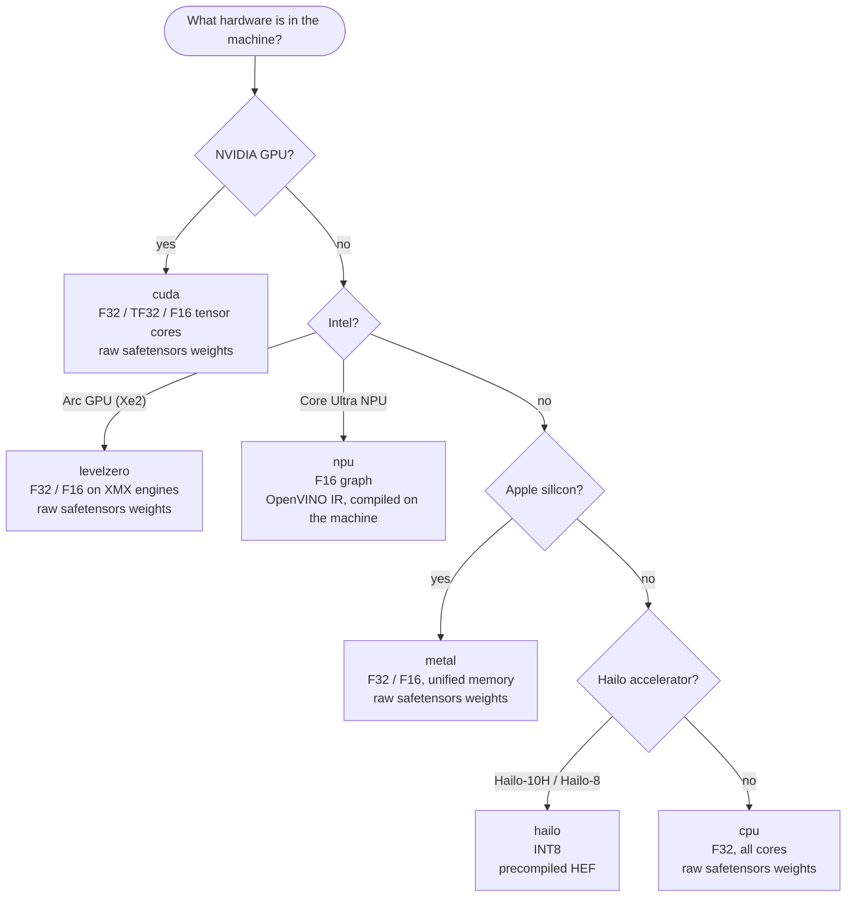
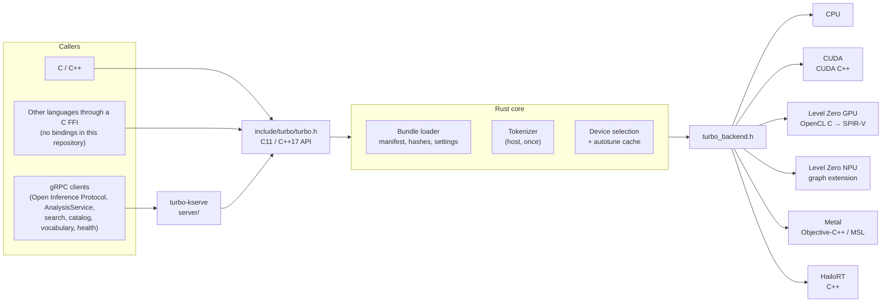
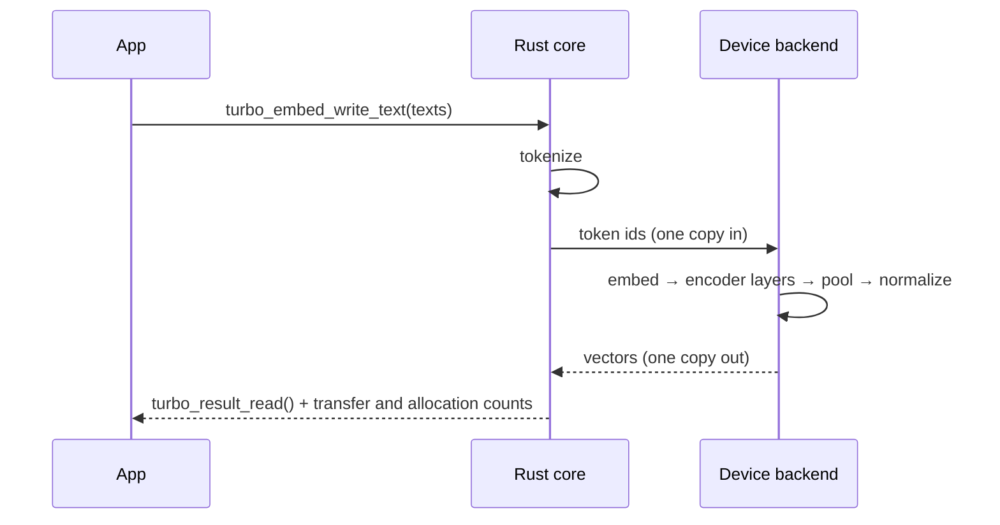

# Embeddings: the core library and its backends

This page covers `libturbo`, the native library at the center of
TurboEmbed (`core/`), for running text encoder models on the hardware a
machine has. It exposes a small C API, and behind that API each backend
is written directly against the vendor's own low-level interface: CUDA on
NVIDIA, Level Zero on Intel GPUs and NPUs, Metal on Apple silicon,
HailoRT on Hailo accelerators, and an optimized CPU path everywhere else.
The rest of the repository (document analysis, the gRPC services and the
tools) is described in the [README](../README.md).

The C API (`include/turbo/turbo.h`) has three tasks:

- `TURBO_TASK_EMBED`: text or token ids in, one pooled vector per row out,
  or one vector per token range (`turbo_embed_write_ranges`, late pooling).
- `TURBO_TASK_RERANK`: query and passage pairs in, one relevance logit per
  pair out (`turbo_rerank_write_pairs`, [reranking.md](reranking.md)).
- `TURBO_TASK_EXTRACTIVE_QA`: question and context windows in, start and
  end logits out ([extractive-qa.md](extractive-qa.md)).

The core's Rust API adds outputs that the C header does not carry:
learned sparse terms from a bundle's masked language model head
(`core/src/sparse.rs`, SPLADE pooling), per-token vectors through a
linear projection head (`core/src/projection.rs`), and a CPU DeBERTa-v3
encoder (`core/src/deberta/`, [deberta.md](deberta.md)) used by the
GLiNER, GLiNER2 and GLiREL extractors. Classification heads carried in a
bundle (`core/src/head.rs`) serve the analysis crates' token tagging and
document classification.

## Supported hardware

| Hardware | Backend | Cargo feature | Model format | Setup |
|---|---|---|---|---|
| Any CPU (Linux, macOS, Windows) | `cpu` | default | safetensors | [cpu.md](setup/cpu.md) |
| NVIDIA GPU (RTX 4080, data-centre cards, Jetson Orin) | `cuda` | `cuda` | safetensors | [cuda.md](setup/cuda.md) |
| Intel Arc GPU, Xe2 / Battlemage (Arc Pro B70) | `levelzero` | `levelzero` | safetensors | [intel-gpu.md](setup/intel-gpu.md) |
| Intel Core Ultra NPU (AI Boost) | `npu` | `npu` | OpenVINO IR | [intel-npu.md](setup/intel-npu.md) |
| Apple silicon Mac (M1 and later) | `metal` | `metal` | safetensors | [apple-metal.md](setup/apple-metal.md) |
| Raspberry Pi 5 with Hailo-10H | `hailo` | `hailo` | HEF | [hailo-10h.md](setup/hailo-10h.md) |
| Hailo-8 / Hailo-8L board (Hailo-8L HEFs are not built, #938) | `hailo` | `hailo` | HEF | [hailo-8.md](setup/hailo-8.md) |

Backends combine in one build (`--features cuda,levelzero`), and the
library lists every device it finds, accelerators first, then the CPU.

### Choosing a backend



GPU backends run the model from its raw weights with kernels of their
own. The NPU and Hailo backends run a graph compiled for the device, so
a bundle needs that compiled artifact to use them. If a device cannot
run a model, the call fails with the reason; the library never quietly
falls back to another device.

### Precision tiers

A session picks one of three tiers. What each resolves to depends on the
device:

| Backend | `MODEL` | `FASTEST` | `EXACT` |
|---|---|---|---|
| CPU | F32 | F32 (a static model sums an I8 copy of its table) | F32 |
| CUDA | F32 (TF32 opt-in) | F16 on tensor cores | F32 |
| Intel GPU | F32 | F16 on matrix engines | F32 |
| Intel NPU | F16 | F16 | not available |
| Apple Metal | F32 | F16 operands in the linear layers, F32 sums | F32 |
| Hailo | INT8 | INT8 | not available |

Every tier is held to an accuracy bound against the reference vectors
carried in the bundle (cosine ≥ 0.9999 for F32, ≥ 0.999 for F16/BF16,
≥ 0.93 for INT8).

A capability cell (`turbo_runtime_capability`) reports SUPPORTED only
where a committed benchmark record in `benchmarks/records/` backs that
device class, task, precision and model; every other cell that runs is
EXPERIMENTAL. Records are committed for an RTX 4080 Super and a Jetson
Orin (CUDA), an Arc Pro B70 (Level Zero), an Arrow Lake NPU, an Apple M2
(Metal), a Hailo-8 and a Hailo-10H, and x86-64 and aarch64 CPUs.

## How it works



- **One task per call.** "Embed these texts" is one call. The backend
  runs every stage on the device and keeps intermediate data there; only
  the final vectors come back. The bytes that crossed to the device and
  back, and the run's host and device allocations, are counted and
  returned with the result (`turbo_result_info`).
- **Models travel as bundles.** A bundle is a directory with a manifest,
  hashes, weights, the tokenizer and the model's settings (pooling,
  normalization, sequence length, prefixes, output dimension). The same
  bundle gives the same answer on every machine.
- **Tokenization happens once, on the host,** so token ids are identical
  regardless of backend.
- **Selection is part of the API.** `turbo_runtime_select` names the
  device that runs a task fastest on this machine, with a one-line
  reason. `turbo_runtime_capability` reports, per device, task and
  precision, the status, the compute dtype, the options honored, the
  cosine floor and speed ratio from the record, and the file name of the
  benchmark record behind a SUPPORTED cell. Choosing among bundles that
  are already loaded is the analysis layer's job
  ([model-routing.md](model-routing.md)).



## Speed over elegance

TurboEmbed deliberately trades elegance for speed. A portable graph
runtime would mean one code path for every device and far less code.
We chose the opposite:

- **A separate backend per vendor,** each in the vendor's own language
  and at the lowest layer it exposes. That means duplicated logic across
  CUDA, OpenCL C, Metal Shading Language and C++, and that is accepted.
- **Kernels tuned per architecture and per shape.** On NVIDIA, GEMM
  tiles, split strategies and attention kernels are chosen per GPU
  generation and input shape, and an autotuner caches what it measures.
- **No generic fallback.** A device either runs the model at full speed
  or refuses it with a reason. Nothing is silently substituted.
- **The vendor's fastest program is the baseline.** If a backend is
  slower than the best reference program on the same inputs (TensorRT,
  OpenVINO, Hugging Face TEI), that is treated as a bug.

Performance claims are backed by data, not prose. A capability is
reported as supported only when a record in `benchmarks/records/` backs
it: a measurement on a named class of device, at a named commit, against
the vendor's fastest program at a pinned version, with the command that
produced it. See [benchmarks.md](benchmarks.md).

## Quick start

```sh
# Build the library with the backend for your hardware
cargo build --release -p turbo --features cuda    # or levelzero, npu, metal, hailo; omit for CPU only

# Build and run the C example against the bundled test model
cc -std=c11 -I include docs/setup/embed.c -L target/release -lturbo \
    -Wl,-rpath,$PWD/target/release -o embed
./embed testdata/tiny-bert-bundle 0 model
```

Each setup page has a check script under `scripts/setup/` that reports
what is missing and, with `--install`, installs it. To run the gRPC
server instead, see [grpc.md](grpc.md).

To run the tests, run the core's apart from the rest, in a target
directory of its own (the CI does the same; #358 explains why):

```sh
cargo test --workspace --exclude turbo
CARGO_TARGET_DIR=target/core cargo test -p turbo
```

To verify a machine produces correct vectors:

```sh
TURBO_TEST_BUNDLE=<bundle-dir> TURBO_TEST_DEVICE=<backend> TURBO_TEST_PRECISION=<tier> \
    cargo test --release -p turbo --features <feature> --test conformance -- --include-ignored
```

## Project principles

- Nothing is called working until it has run on real hardware. Tests
  that cannot run on the current machine are skipped and say so.
- Model settings live in the bundle, not in code.
- No Python in the library, the server or the tools' own code paths.
  The Python files in the tree are reference, fixture and peer programs
  (for example `bundle/hailo/hef_compile.py` and the scripts under
  `bench/static-peers/`), run in pinned containers or by hand to produce
  goldens and comparison numbers.
- The C header is designed by hand; changes to it are design decisions,
  and nothing is added that a built feature does not need.

## Documentation

| Topic | Page |
|---|---|
| Bundle format and `turbo-bundle` | [bundle.md](bundle.md), [setup/bundles.md](setup/bundles.md) |
| Model zoo, `turbo-zoo`, and the licences of datasets and checkpoints | [zoo.md](zoo.md), [licences.md](licences.md) |
| Tokenizers | [tokenizer.md](tokenizer.md) |
| Conformance testing | [conformance.md](conformance.md) |
| Benchmark records and `turbo-bench` | [benchmarks.md](benchmarks.md) |
| Autotuning | [autotune.md](autotune.md) |
| Static (Model2Vec-style) models | [static.md](static.md) |
| Reranking and extractive QA | [reranking.md](reranking.md), [extractive-qa.md](extractive-qa.md) |
| DeBERTa-v3 encoder | [deberta.md](deberta.md) |
| gRPC server and KServe mapping | [grpc.md](grpc.md), [kserve.md](kserve.md) |
| Backends | [CPU](cpu.md), [CUDA](cuda.md), [Intel GPU](levelzero.md), [Intel NPU](npu.md), [Metal](metal.md), [Hailo](hailo.md) |
| Setup for each machine | [setup/README.md](setup/README.md) |
| Releases | [release.md](release.md) |

The full documentation index, including the analysis, search and gRPC
service pages, is in the [README](../README.md#documentation).

## License

Apache-2.0; see [LICENSE](../LICENSE). The CUDA backend includes a subset of
NVIDIA's CUTLASS headers under `core/cuda/cutlass/` (BSD-3-Clause; see
`core/cuda/cutlass/LICENSE.txt`).
